# Shared tabletop design review

These captures render the same `TabletopSurface`, `TabletopPlayerPanel`, and
`TabletopPlaceActions` components used by the live game. There is no separate
mockup composition. The fixture contains five merchants with varied inventories.

Open `/mockups/tabletop/?place=10&seat=6`; `place=1` through `16` selects a room,
and `seat=1` through `8` chooses the active physical position. Preview actions
are fixtures, not a saved game. Use `/tabletop/` for actual play.

The live interaction contract:

- One readable mat per merchant, at their physical seat. Goods show count and
  capacity, alongside Lira, assistants, private-card count, and rubies.
- Tap a reachable room to move. The room action appears immediately beside the
  board, with no inspector, room-opening tap, or modal confirmation.
- Tap the warehouse goods to fill, a Mosque tile to buy it, or a destination on
  the existing board to send family. Market sales start with all matching goods.
- Fountain room taps cycle the number of assistants to recall; Recall all is
  available immediately. Yellow Mosque recalls also use the existing board.
- Encounters and Mosque follow-up choices remain inline. Private Bonus-card
  choices stay on the phone.
- Undo and an inline game log remain available. End turn is explicit so the
  merchant can still undo or play a Bonus card before passing.
- The board and controls face the active seat; mats retain their physical place.
  Narrow screens use a compact resource grid above the board.

The browser layout sweep checks every room across four physical orientations at
phone, desktop, and 4K sizes. The shared-table journey checks direct movement,
immediate actions, private phones, handoff, reload, and one-tap undo.

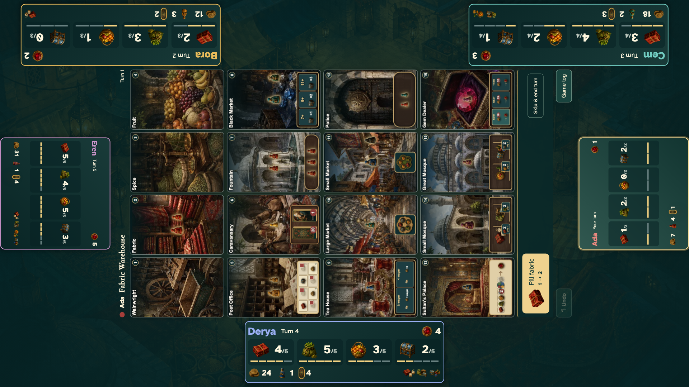
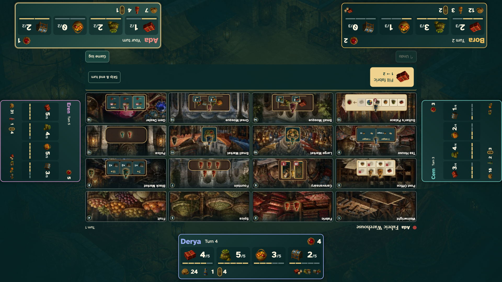

## Room views

1. Wainwright — direct 7-Lira-to-extension exchange

   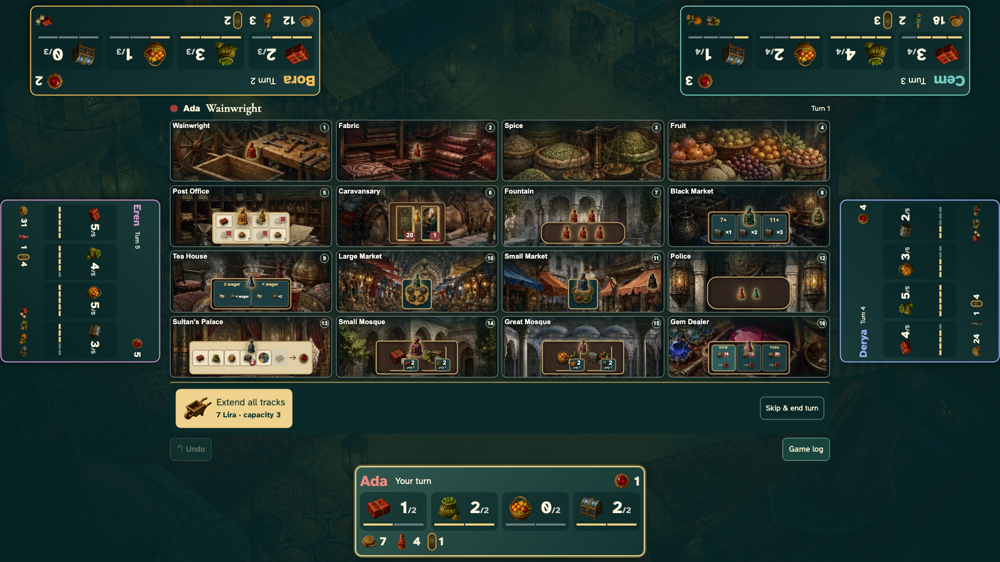

2. Fabric Warehouse — supply pile filling a capacity track

   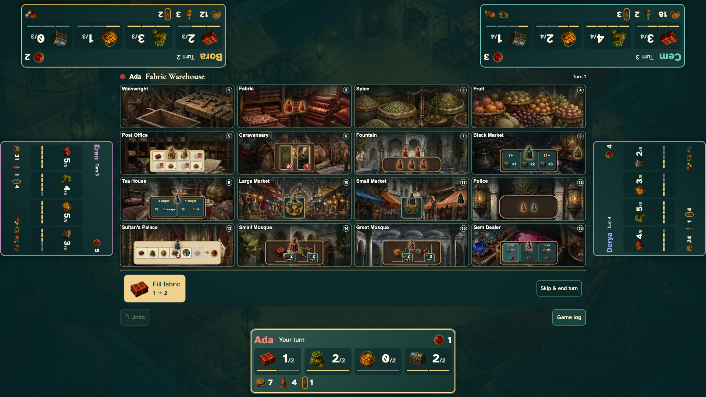

3. Spice Warehouse — supply pile filling a capacity track

   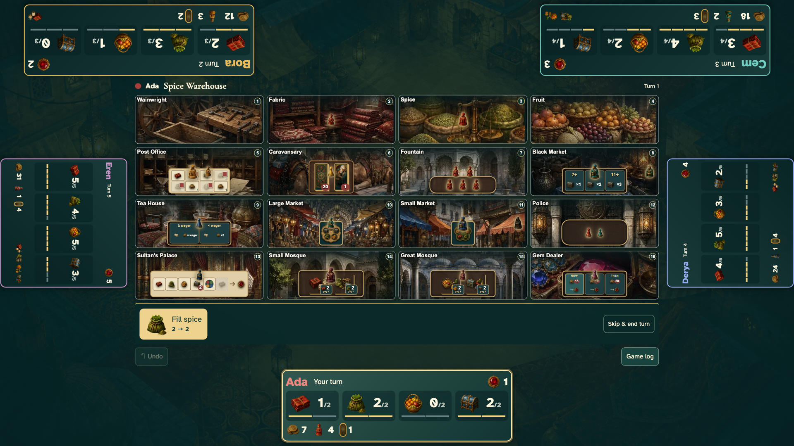

4. Fruit Warehouse — supply pile filling a capacity track

   

5. Post Office — four exposed mail-track rewards

   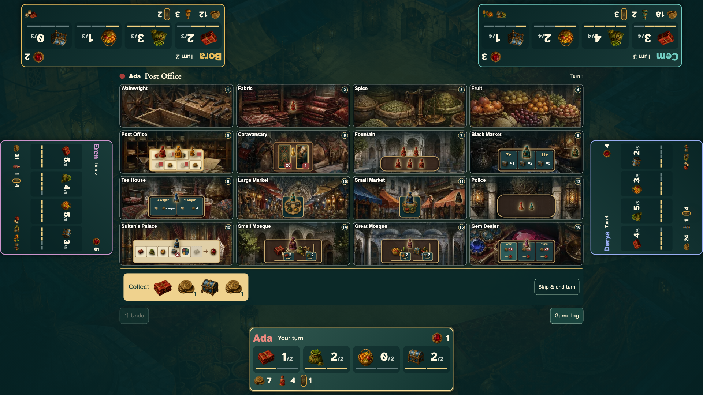

6. Caravansary — private-phone handoff

   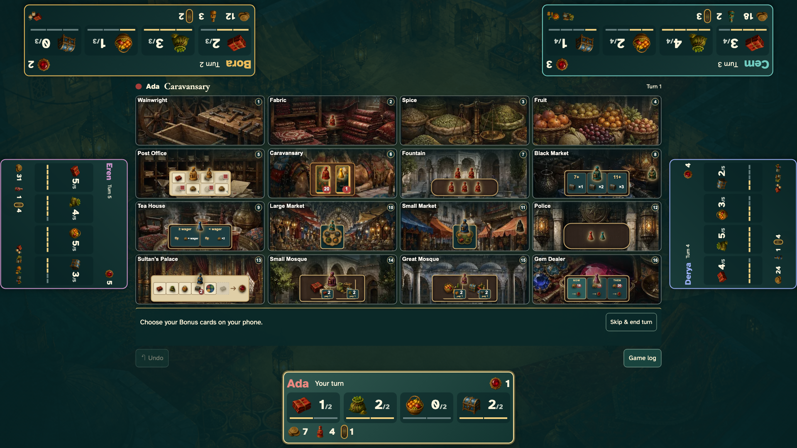

7. Fountain — assistants selected on the board and recalled to the merchant

   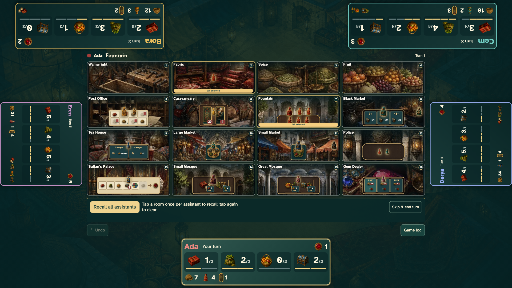

8. Black Market — basic-good picker plus visible dice thresholds

   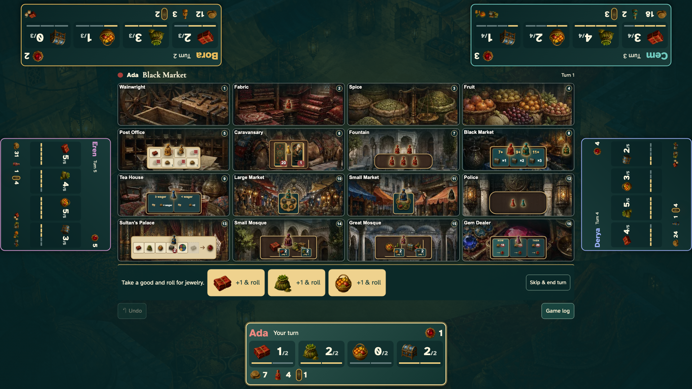

9. Tea House — wager choices and direct roll

   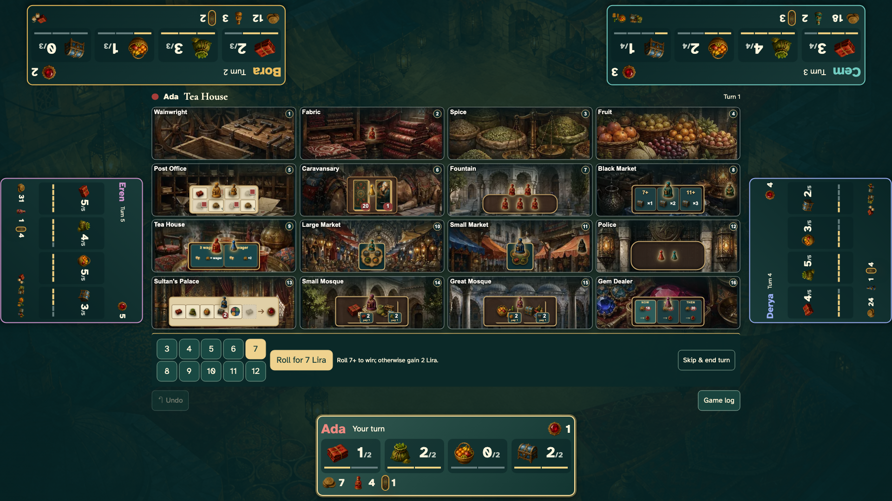

10. Large Market — demand tile, selectable demand slots, and live payout

    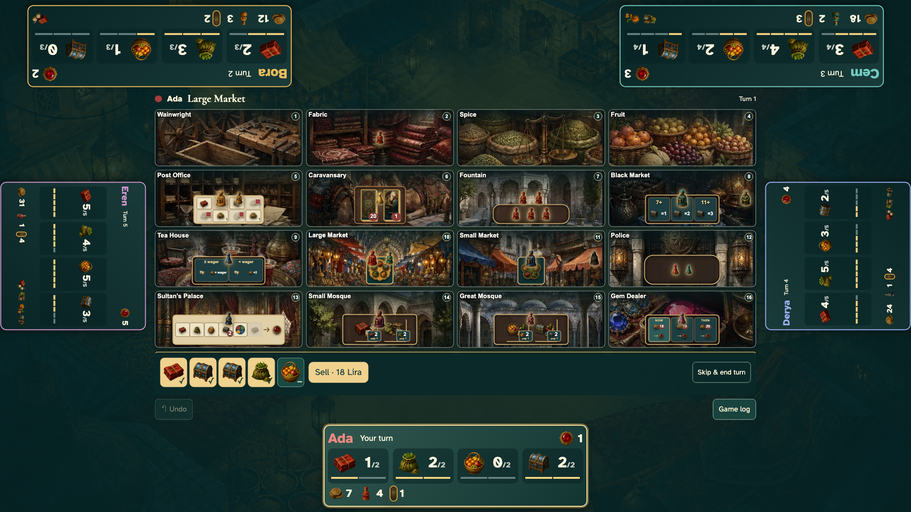

11. Small Market — demand tile, selectable demand slots, and live payout

    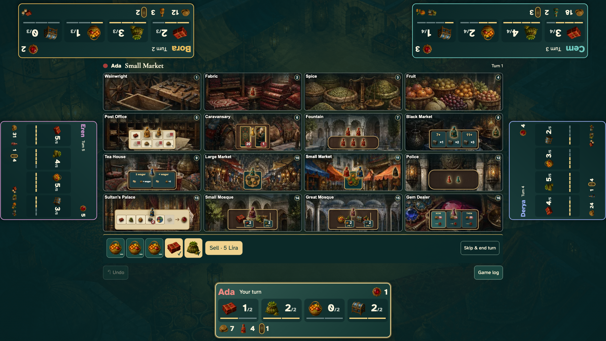

12. Police Station — destination selection on the live board

    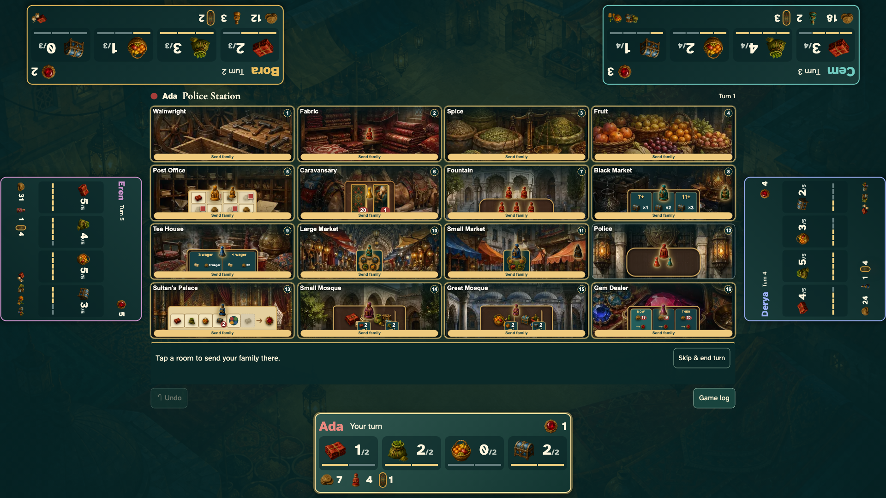

13. Sultan's Palace — escalating goods offer matched against inventory

    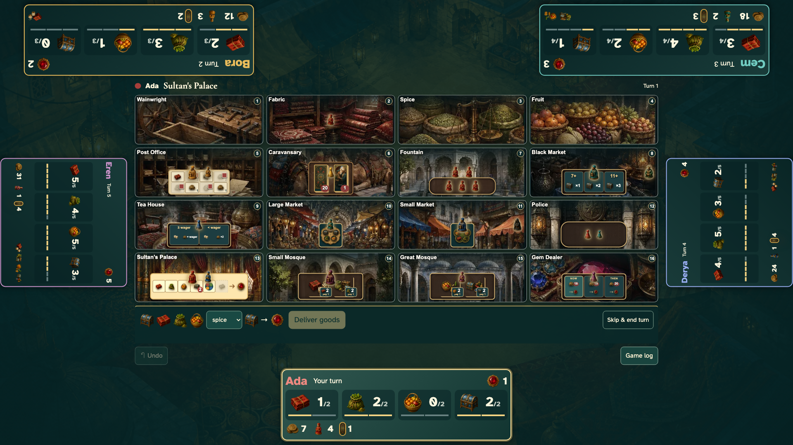

14. Small Mosque — graphical tile abilities and their goods costs

    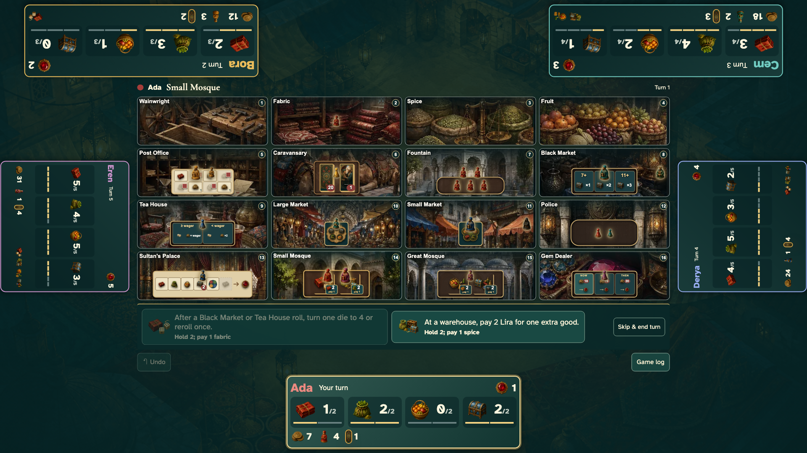

15. Great Mosque — graphical tile abilities and their goods costs

    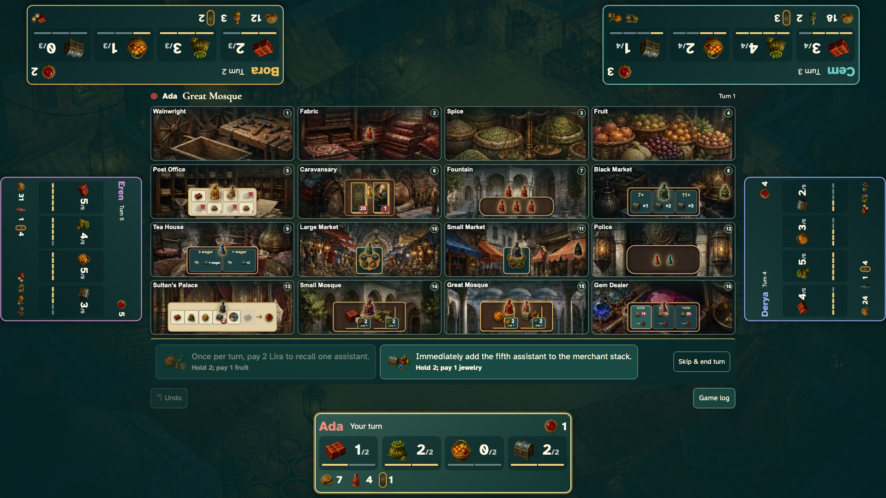

16. Gemstone Dealer — current/next prices and direct Lira-to-ruby exchange

    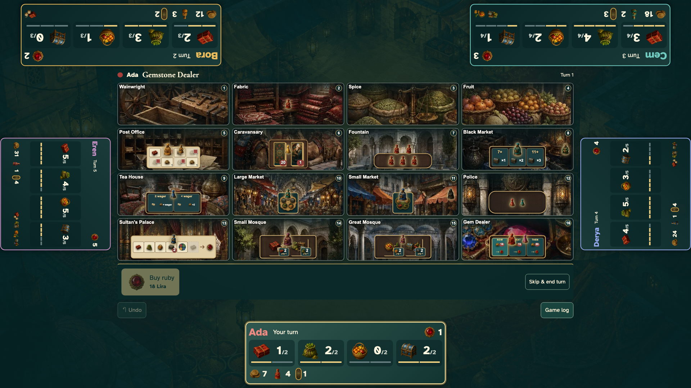
