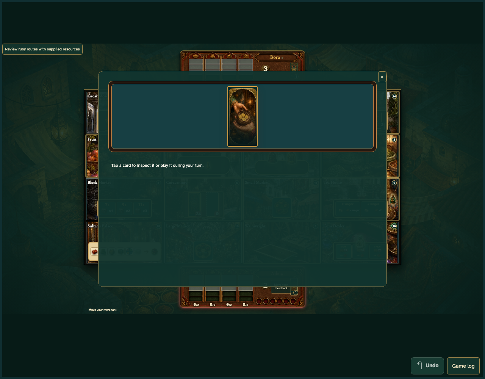

# Private cards belong to their owner

Real browser actions on the common game table, with immutable replay and private-card boundaries.

## 1. Private cards belong to their owner

**Player** — Private cards belong to their owner

**Verifications:**

- [x] The game state and visible components agree
