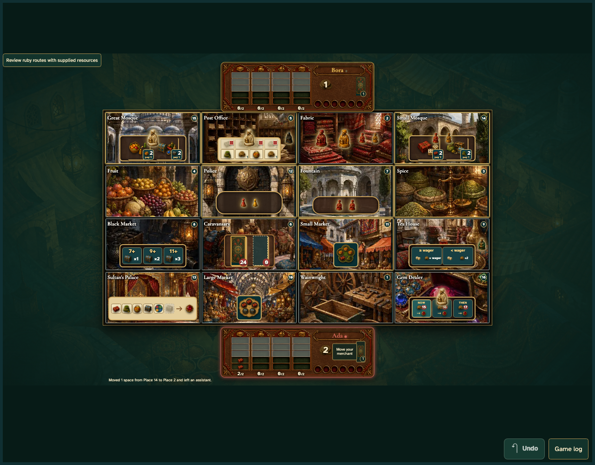

# Unpayable tolls require acknowledgement

Real browser actions on the common game table, with immutable replay and private-card boundaries.

## 1. Unpayable tolls require acknowledgement

**Player** — Unpayable tolls require acknowledgement

**Verifications:**

- [x] The game state and visible components agree
