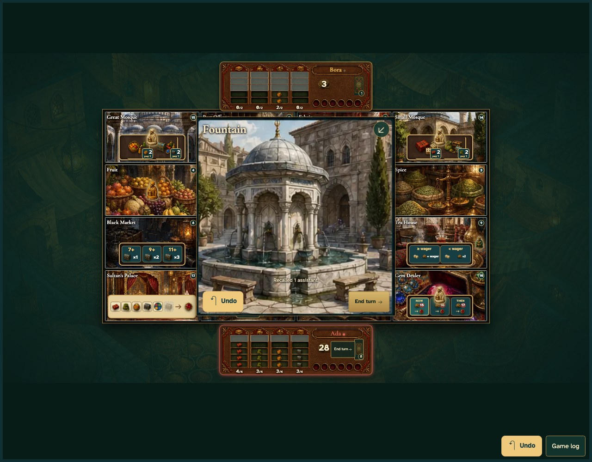

# A larger wheelbarrow fills directly and assistants return at the Fountain

Real browser actions on the common game table, with immutable replay and private-card boundaries.

## 1. A larger wheelbarrow fills directly and assistants return at the Fountain

**Player** — A larger wheelbarrow fills directly and assistants return at the Fountain

**Verifications:**

- [x] The game state and visible components agree
