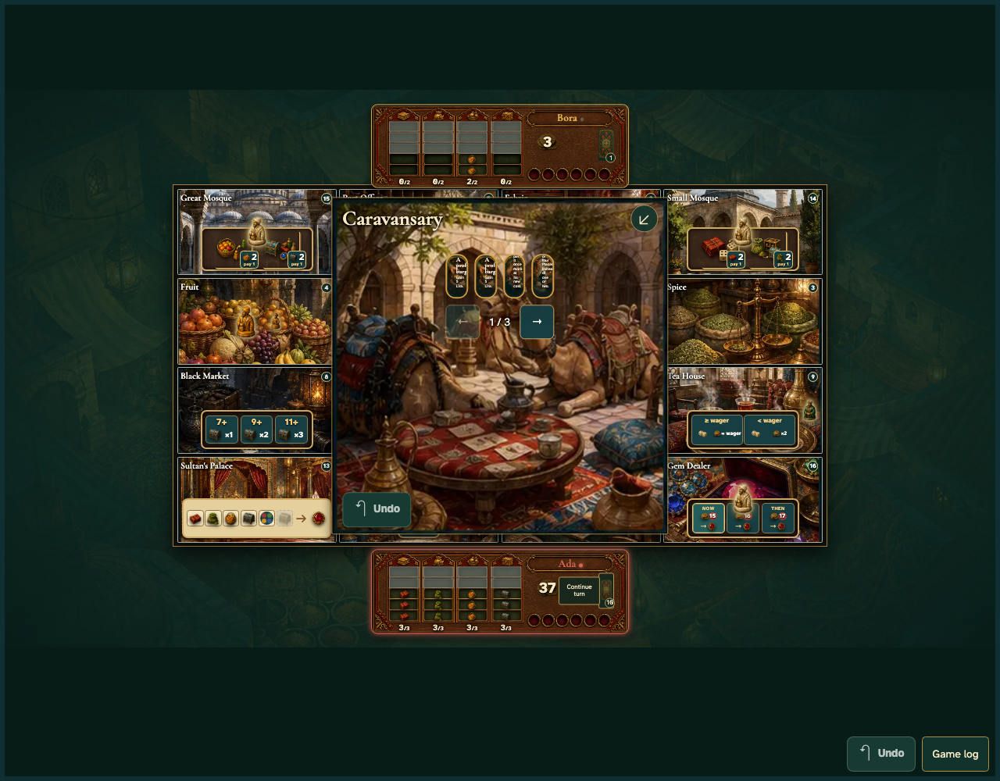
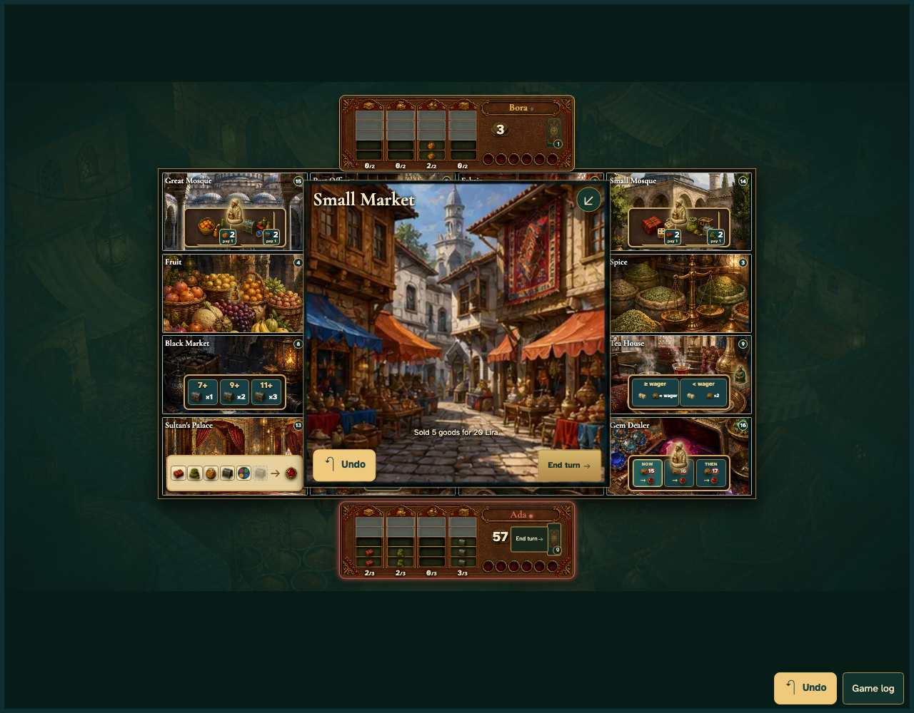

# Draw and discard actual cards inside the room, then sell prepared goods

Real browser actions on the common game table, with immutable replay and private-card boundaries.

## 1. Choose the actual card to discard inside the Caravansary

**Player** — Choose the actual card to discard inside the Caravansary

**Verifications:**

- [x] Drawn cards are visible in the room

## 2. Draw and discard actual cards inside the room, then sell prepared goods

**Player** — Draw and discard actual cards inside the room, then sell prepared goods

**Verifications:**

- [x] The game state and visible components agree
