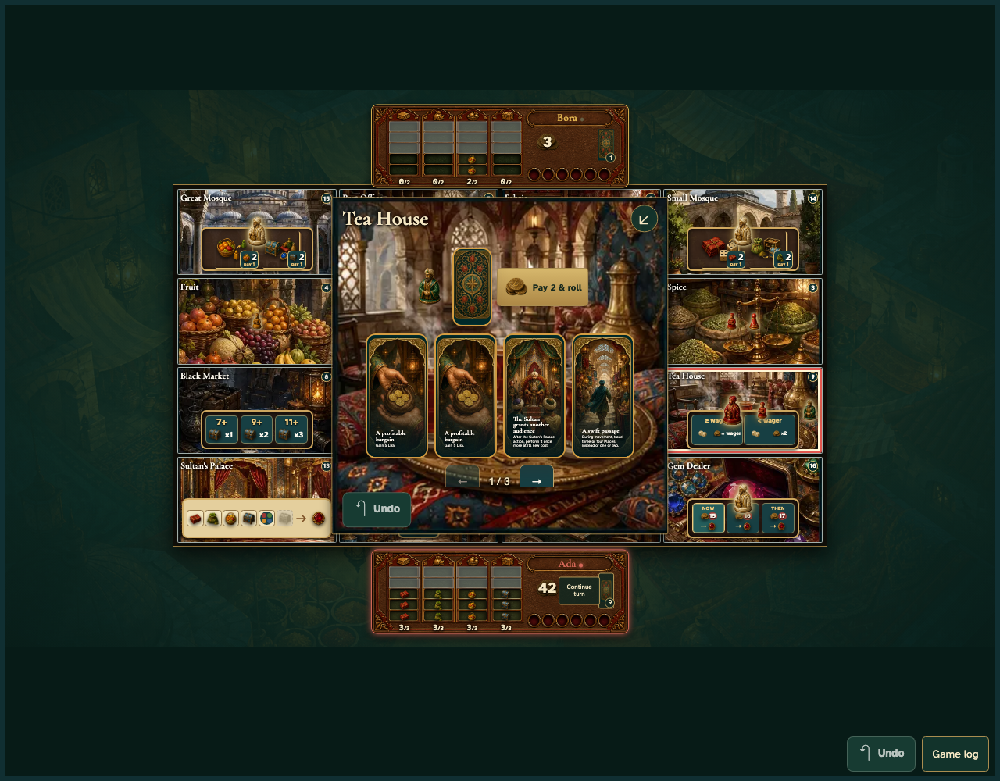
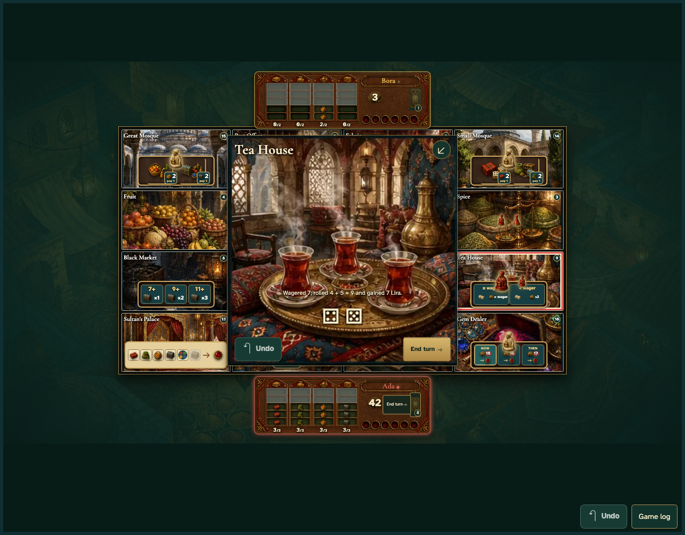

# Family actions resolve in their destination and NPC offers use pieces and cards

Real browser actions on the common game table, with immutable replay and private-card boundaries.

## 1. Pay the Governor with a card from the visible hand

**Player** — Pay the Governor with a card from the visible hand

**Verifications:**

- [x] The cards themselves are the payment controls

## 2. Family actions resolve in their destination and NPC offers use pieces and cards

**Player** — Family actions resolve in their destination and NPC offers use pieces and cards

**Verifications:**

- [x] The game state and visible components agree
