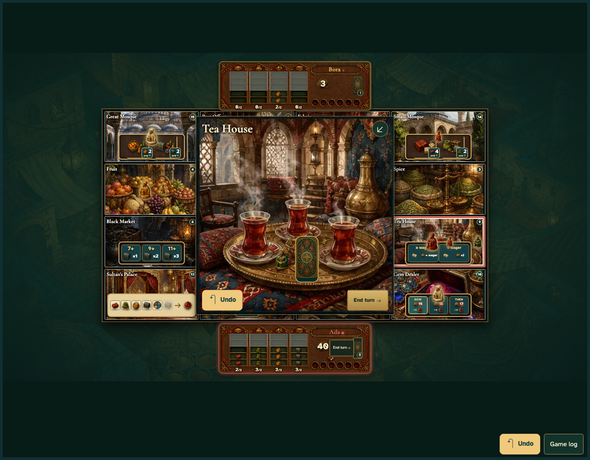

# An acquired Mosque tile offers its dice control in the room

Real browser actions on the common game table, with immutable replay and private-card boundaries.

## 1. An acquired Mosque tile offers its dice control in the room

**Player** — An acquired Mosque tile offers its dice control in the room

**Verifications:**

- [x] The game state and visible components agree
