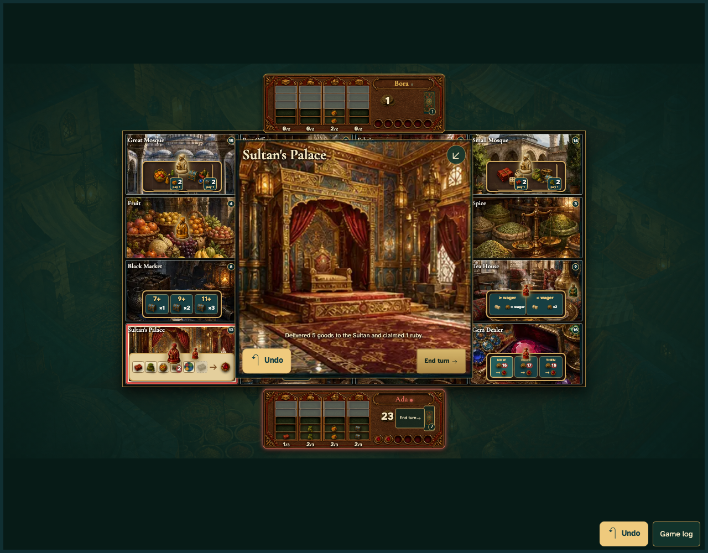

# Ruby routes and private Bonus cards work on the common table

Real browser actions on the common game table, with immutable replay and private-card boundaries.

## 1. Ruby routes and private Bonus cards work on the common table

**Player** — Ruby routes and private Bonus cards work on the common table

**Verifications:**

- [x] The game state and visible components agree
