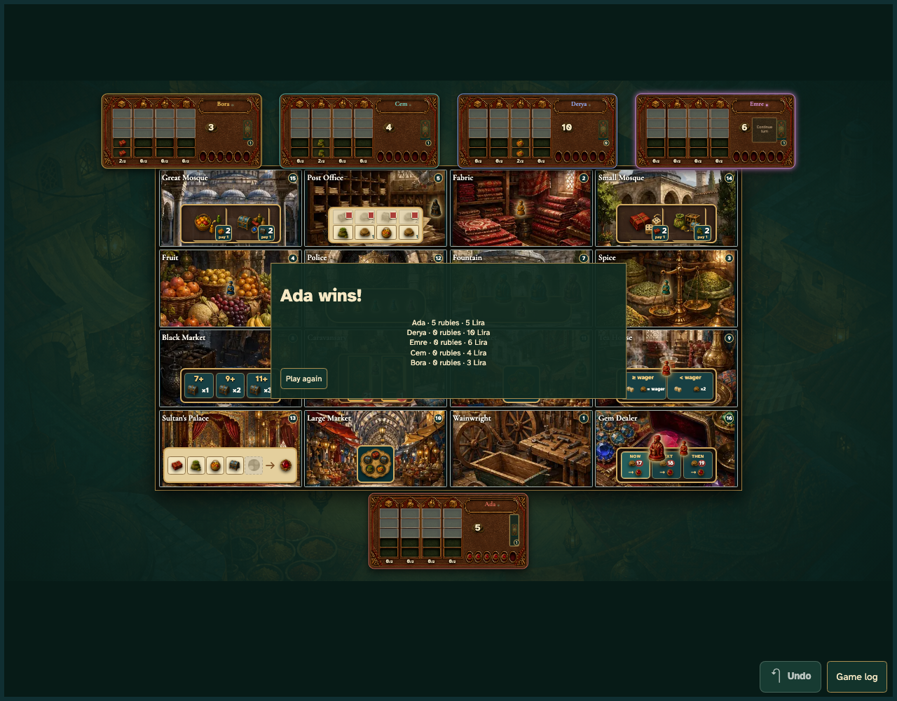

# Five players finish a full game on the common table

Real browser actions on the common game table, with immutable replay and private-card boundaries.

## 1. Five players finish a full game on the common table

**Player** — Five players finish a full game on the common table

**Verifications:**

- [x] The game state and visible components agree
