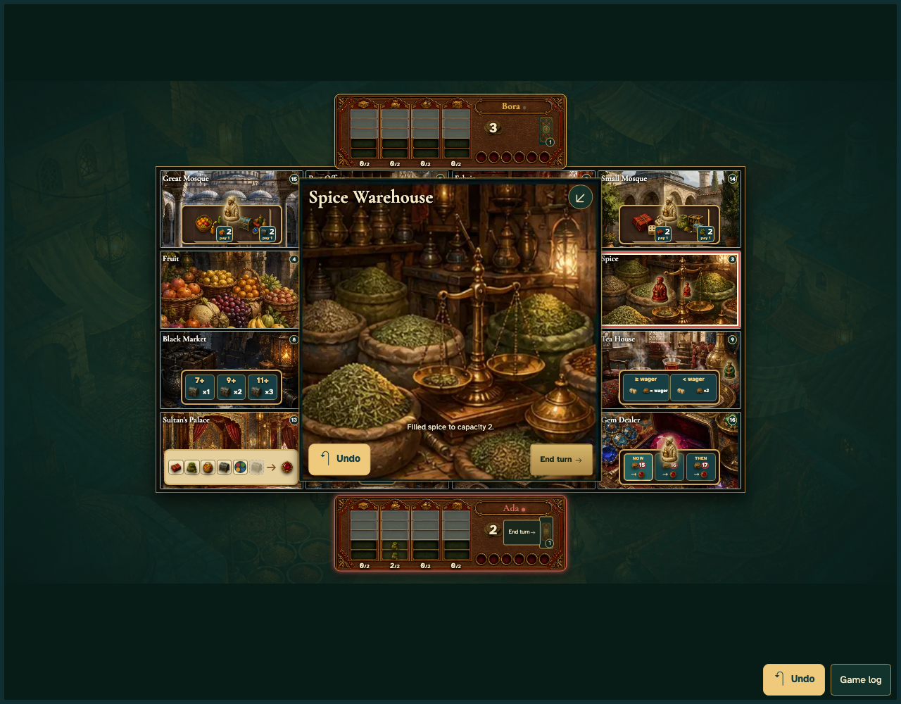

# The board, mats and room all use the production art

Real browser actions on the common game table, with immutable replay and private-card boundaries.

## 1. The board, mats and room all use the production art

**Player** — The board, mats and room all use the production art

**Verifications:**

- [x] The game state and visible components agree
