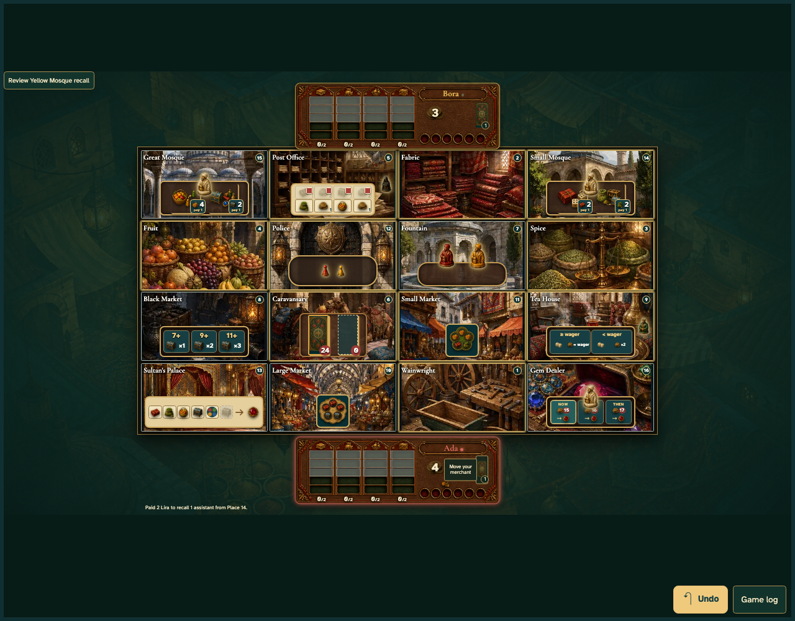

# Tap the Mosque power, then its assistant’s room

Real browser actions on the common game table, with immutable replay and private-card boundaries.

## 1. Tap the Mosque power, then its assistant’s room

**Player** — Tap the Mosque power, then its assistant’s room

**Verifications:**

- [x] The game state and visible components agree
