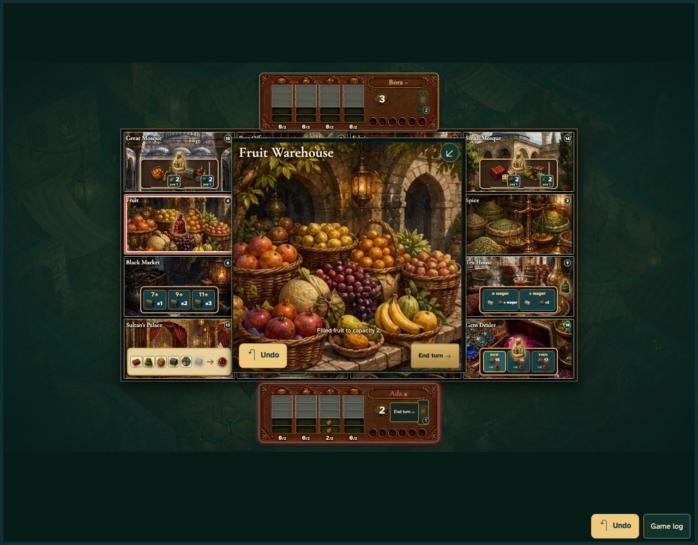

# Staying performs the normal assistant action and warehouse fill

Real browser actions on the common game table, with immutable replay and private-card boundaries.

## 1. Staying performs the normal assistant action and warehouse fill

**Player** — Staying performs the normal assistant action and warehouse fill

**Verifications:**

- [x] The game state and visible components agree
