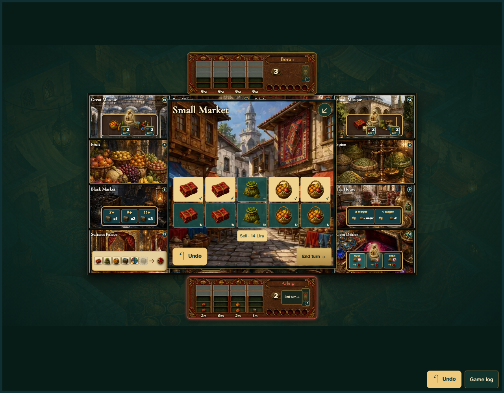

# Change market payment on the actual demand

Real browser actions on the common game table, with immutable replay and private-card boundaries.

## 1. Change market payment on the actual demand

**Player** — Change market payment on the actual demand

**Verifications:**

- [x] The game state and visible components agree
