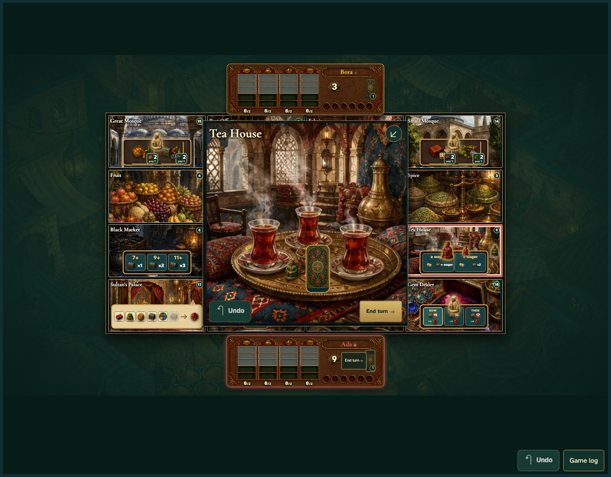

# Undo reverses arrival and goods but stops at a revealed roll

Real browser actions on the common game table, with immutable replay and private-card boundaries.

## 1. Undo reverses arrival and goods but stops at a revealed roll

**Player** — Undo reverses arrival and goods but stops at a revealed roll

**Verifications:**

- [x] The game state and visible components agree
