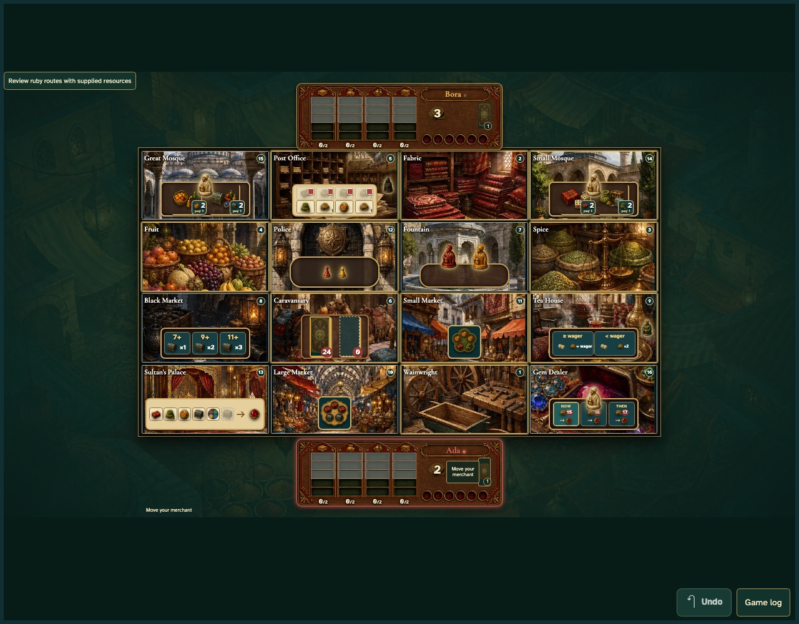

# Roll back a direct arrival from its game-log entry

Real browser actions on the common game table, with immutable replay and private-card boundaries.

## 1. Roll back a direct arrival from its game-log entry

**Player** — Roll back a direct arrival from its game-log entry

**Verifications:**

- [x] The game state and visible components agree
