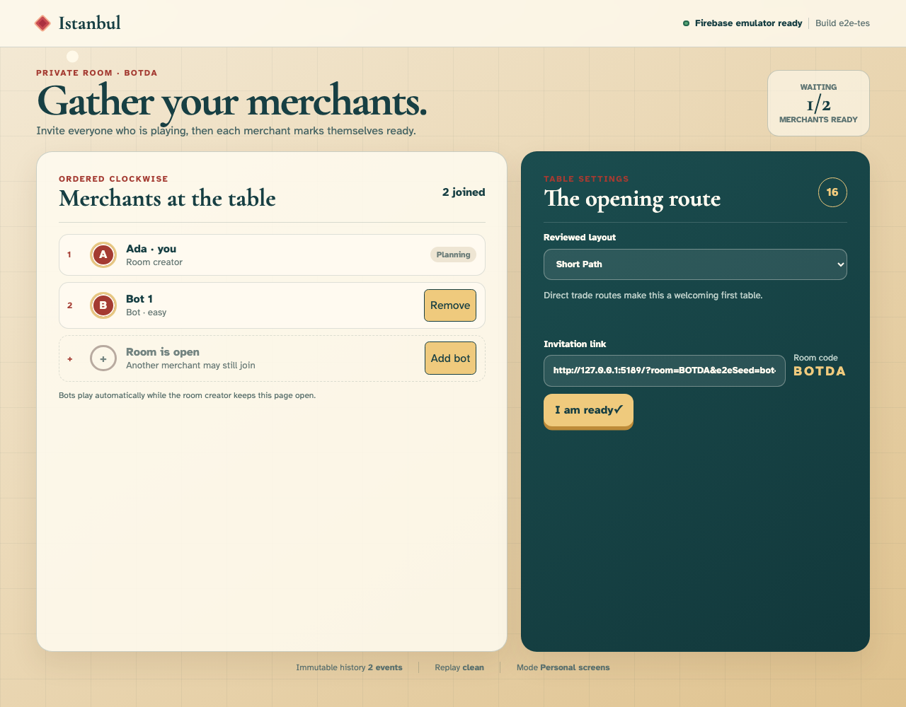
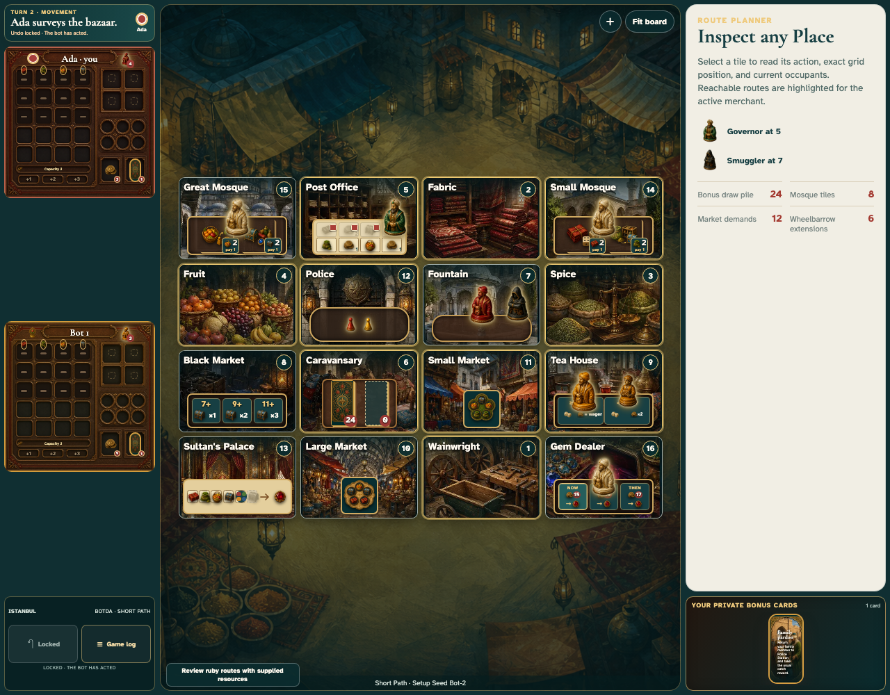

# Play against an easy bot

A solo host adds and removes a bot in the ordinary lobby, starts a game, and reloads during its opening turn. The bot resumes automatically and hands control back to the human. The companion test verifies a shared tabletop with a private phone and two host tabs.

## 1. The bot joins ready to play

**Player** — The bot joins ready to play

**Verifications:**

- [x] The easy bot is named and can be removed before starting
- [x] The host is told to keep the page open for automatic bot turns

## 2. After reload, the bot finishes its turn and Ada can play

**Player** — After reload, the bot finishes its turn and Ada can play

**Verifications:**

- [x] The bot made a legal move and the same history survives another reload
- [x] The human has the normal sixteen-room board
