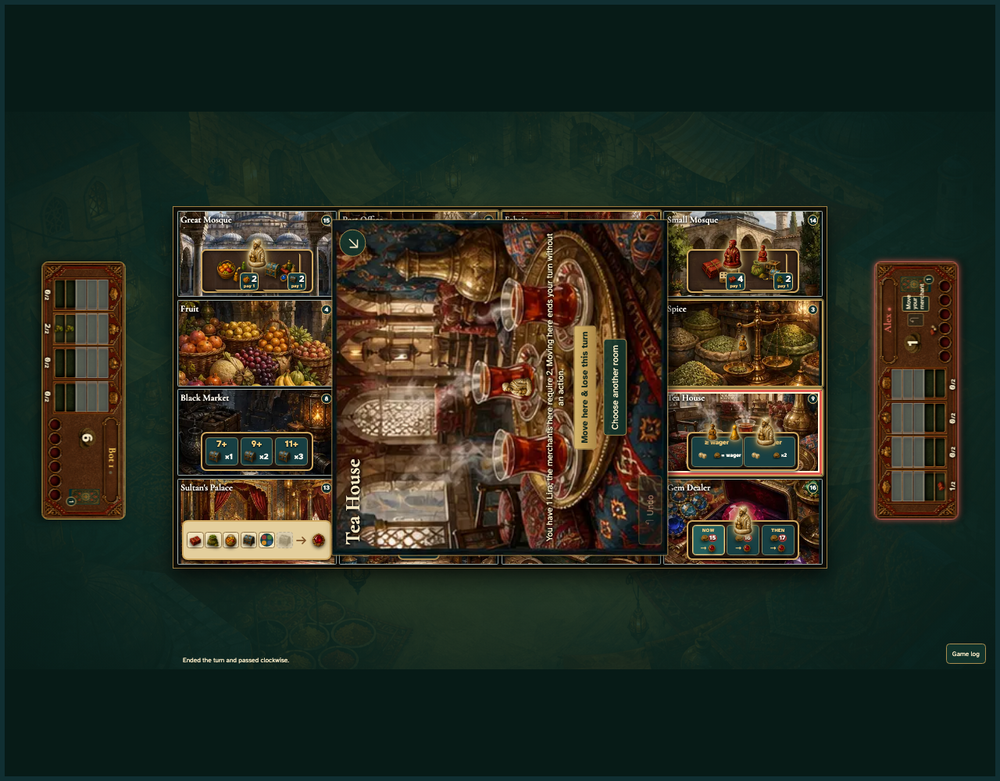

# Choose before losing a turn

An unaffordable neutral merchant opens a warning on the room itself. Backing out leaves all game state unchanged; only the explicit lost-turn button commits the move and lets the bot play.

## 1. The Tea House shows the neutral merchant and explains the lost turn before moving

**Player** — The Tea House shows the neutral merchant and explains the lost turn before moving

**Verifications:**

- [x] The player must explicitly acknowledge losing the turn
- [x] No move or bot action has entered history
