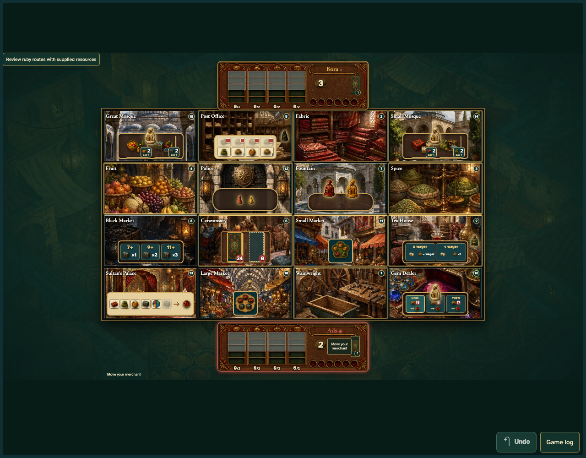
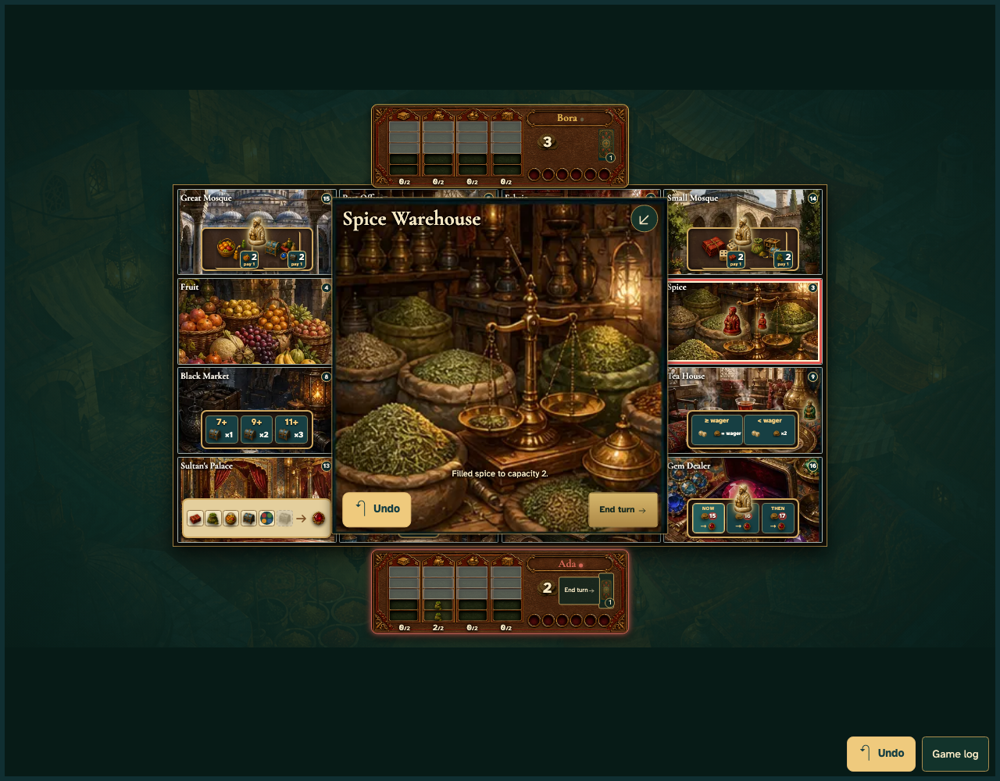
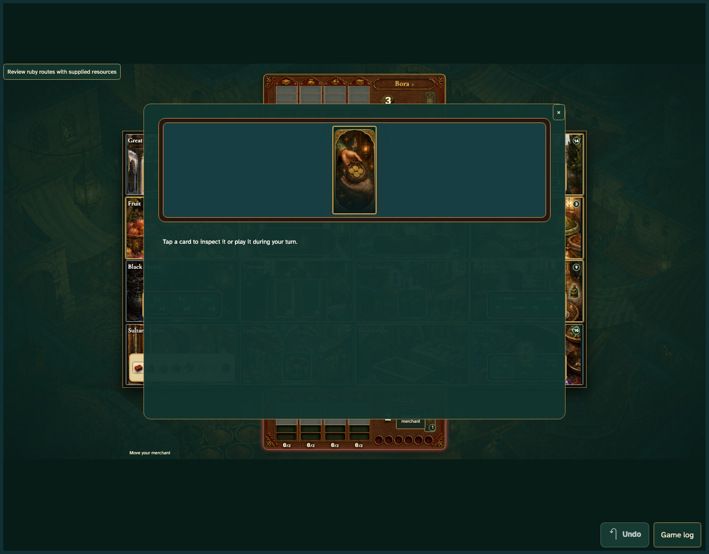

# One table for every screen

Personal play uses the same illustrated board, mats, room actions and undo as the shared tabletop. Room artwork grows from its board position over one second. Private Bonus cards stay on their owner’s screen.

## 1. The regular game uses the same board and compact mats

**Player** — The regular game uses the same board and compact mats

**Verifications:**

- [x] A single game surface replaces the old sidebar

## 2. One tap moves and fills spice while the warehouse smoothly enlarges

**Player** — One tap moves and fills spice while the warehouse smoothly enlarges

**Verifications:**

- [x] The ordinary fill needs no second tap

## 3. Bonus cards open from the player mat

**Player** — Bonus cards open from the player mat

**Verifications:**

- [x] Only the local player’s hand is shown
