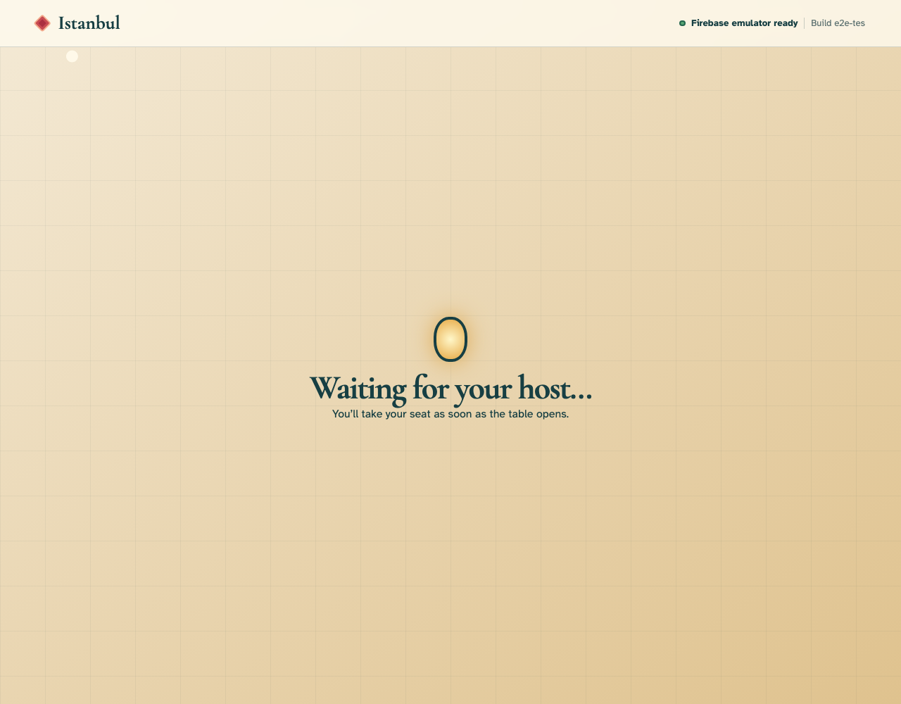
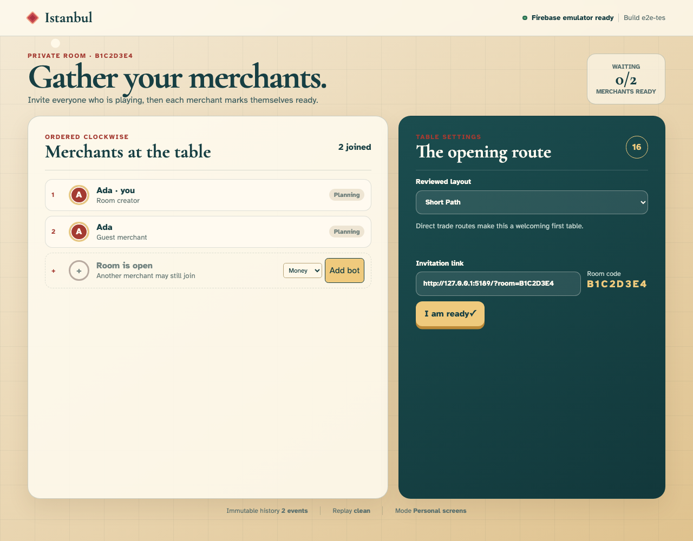

# Launch Istanbul from Gameroom

Invitations seat authenticated players without another name form, preserve table codes, and resume safely.

## 1. A guest arrives before the host

**Guest** — A guest arrives before the host

**Verifications:**

- [x] Waiting does not create a room

## 2. Gameroom opens the shared lobby

**Host** — Gameroom opens the shared lobby

**Verifications:**

- [x] Two identities with the same name keep separate seats
